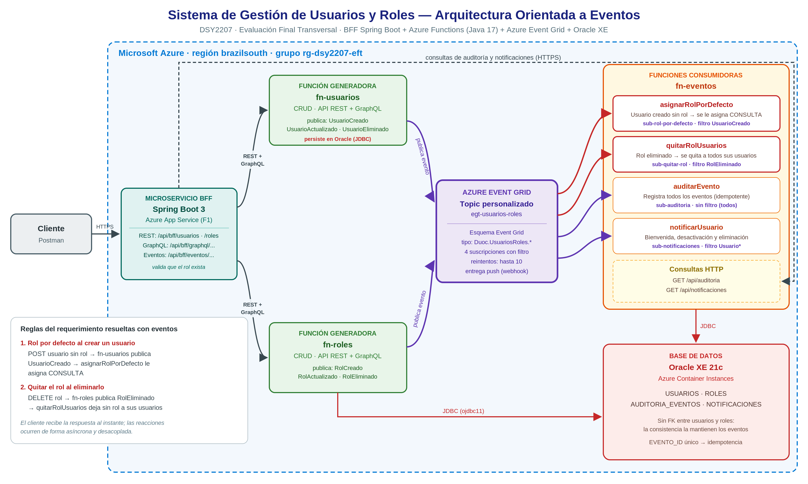

# Sistema de Gestión de Usuarios y Roles · Arquitectura Orientada a Eventos

**DSY2207 - Desarrollo Cloud Native II · Evaluación Final Transversal (Semana 9)**

Sistema backend que permite operaciones CRUD sobre usuarios y roles mediante
**funciones serverless en Java** (Azure Functions), orquestadas por un **microservicio
BFF en Spring Boot**. El sistema usa **Azure Event Grid** para resolver dos reglas del
requerimiento de forma asíncrona:

1. **Al crear un usuario, se le asigna automáticamente un rol por defecto** (`CONSULTA`, de solo lectura).
2. **Al eliminar un rol, se actualizan los usuarios que lo tenían y se les quita.**

Todas las piezas están desplegadas en **Microsoft Azure**.



---

## 1. Componentes

| Componente | Tecnología | Despliegue en Azure | Rol |
|---|---|---|---|
| `bff-usuarios-roles` | Spring Boot 3 (Java 17) | App Service (plan F1) | Orquesta las funciones vía **REST y GraphQL** |
| `funcion-usuarios` | Azure Functions (Java 17) | Function App | CRUD de usuarios (REST + GraphQL). Publica eventos `Usuario*` |
| `funcion-roles` | Azure Functions (Java 17) | Function App | CRUD de roles (REST + GraphQL). Publica eventos `Rol*` |
| `funcion-eventos` | Azure Functions (Java 17) | Function App | Funciones consumidoras (`EventGridTrigger`) y consultas |
| Event Grid | Topic personalizado | Event Grid | Distribuye los eventos según suscripciones con filtro |
| Oracle XE 21c | Contenedor | Container Instances | Tablas `USUARIOS`, `ROLES`, `AUDITORIA_EVENTOS`, `NOTIFICACIONES` |

## 2. Reglas del requerimiento resueltas con eventos

### Regla 1: rol por defecto al crear un usuario

```
POST /api/bff/usuarios  (sin rolId)
  → funcion-usuarios guarda el usuario y publica Duoc.UsuariosRoles.UsuarioCreado
  → Event Grid (suscripción sub-rol-por-defecto, filtro UsuarioCreado)
  → asignarRolPorDefecto le asigna el rol CONSULTA
```

Si el usuario se crea con un rol explícito, se respeta el que trae.

### Regla 2: quitar el rol a sus usuarios al eliminarlo

```
DELETE /api/bff/roles/{id}
  → funcion-roles elimina el rol y publica Duoc.UsuariosRoles.RolEliminado
  → Event Grid (suscripción sub-quitar-rol, filtro RolEliminado)
  → quitarRolUsuarios deja ROL_ID = NULL en todos los usuarios que lo tenían
```

### Catálogo de eventos y suscripciones

| Evento | Lo publica | Suscripciones que lo reciben |
|---|---|---|
| `UsuarioCreado` | funcion-usuarios | sub-rol-por-defecto, sub-notificaciones, sub-auditoria |
| `UsuarioActualizado` | funcion-usuarios | sub-notificaciones, sub-auditoria |
| `UsuarioEliminado` | funcion-usuarios | sub-notificaciones, sub-auditoria |
| `RolCreado` | funcion-roles | sub-auditoria |
| `RolActualizado` | funcion-roles | sub-auditoria |
| `RolEliminado` | funcion-roles | sub-quitar-rol, sub-auditoria |

| Función consumidora | Suscripción | Acción |
|---|---|---|
| `asignarRolPorDefecto` | sub-rol-por-defecto | Regla 1 |
| `quitarRolUsuarios` | sub-quitar-rol | Regla 2 |
| `auditarEvento` | sub-auditoria (todos) | Traza de todos los eventos en `AUDITORIA_EVENTOS` |
| `notificarUsuario` | sub-notificaciones | Avisos de bienvenida, desactivación y eliminación |

### Decisiones de diseño

- **Sin clave foránea entre usuarios y roles.** Cada función es dueña de sus datos; la
  consistencia entre ambos la mantienen los eventos (consistencia eventual). Por eso el
  BFF, como orquestador, valida que el rol exista antes de crear o actualizar un usuario.
- **Idempotencia.** Event Grid entrega "al menos una vez". Las reacciones no duplican
  efectos: la auditoría y las notificaciones usan el id del evento como clave única, y
  las actualizaciones de rol son idempotentes por diseño.
- **Reintentos.** Si una función consumidora falla, Event Grid reintenta la entrega
  (hasta 10 intentos con backoff exponencial).
- **Las operaciones se publican desde REST y desde GraphQL**, con el SDK oficial
  `azure-messaging-eventgrid`.

## 3. API del BFF

URL base en Azure: `https://<app-bff>.azurewebsites.net`

### Integración vía REST

| Método | Ruta | Descripción |
|---|---|---|
| GET / POST | `/api/bff/usuarios` | Listar / crear usuarios |
| GET / PUT / DELETE | `/api/bff/usuarios/{id}` | Obtener / actualizar / eliminar usuario |
| GET / POST | `/api/bff/roles` | Listar / crear roles |
| GET / PUT / DELETE | `/api/bff/roles/{id}` | Obtener / actualizar / eliminar rol |

### Integración vía GraphQL

El BFF expone el mismo CRUD, pero lo resuelve invocando la capa **GraphQL**
(`/api/graphql`) de cada función:

| Método | Ruta | Operación GraphQL usada |
|---|---|---|
| GET / POST | `/api/bff/graphql/usuarios` | `usuarios` / `crearUsuario` |
| GET / PUT / DELETE | `/api/bff/graphql/usuarios/{id}` | `usuario` / `actualizarUsuario` / `eliminarUsuario` |
| GET / POST | `/api/bff/graphql/roles` | `roles` / `crearRol` |
| GET / PUT / DELETE | `/api/bff/graphql/roles/{id}` | `rol` / `actualizarRol` / `eliminarRol` |

### Eventos

| Método | Ruta | Descripción |
|---|---|---|
| GET | `/api/bff/eventos/auditoria?tipo=` | Historial de eventos procesados |
| GET | `/api/bff/eventos/notificaciones` | Notificaciones generadas por eventos |

## 4. Estructura del proyecto

```
EFT-Sistema-Usuarios-Roles/
├── bff-usuarios-roles/          Microservicio BFF (Spring Boot)
├── funcion-usuarios/            Función serverless de usuarios (REST + GraphQL)
├── funcion-roles/               Función serverless de roles (REST + GraphQL)
├── funcion-eventos/             Funciones consumidoras de Event Grid
├── db/oracle/                   Script de la base de datos Oracle
├── docker-compose.yml           Ejecución local con Docker (emulador de Event Grid)
├── docker-compose.azure.yml     BFF local apuntando a las funciones en Azure
├── infra/azure/desplegar.sh     Despliegue completo en Azure
└── docs/                        Diagrama y colección de Postman
```

## 5. Ejecución local con Docker

```bash
docker compose up -d --build
```

| Servicio | URL local |
|---|---|
| BFF | http://localhost:8080 |
| funcion-usuarios | http://localhost:7071/api/usuarios |
| funcion-roles | http://localhost:7072/api/roles |
| funcion-eventos | http://localhost:7073/api/auditoria |

Localmente, Azure Event Grid se reemplaza por un emulador
(`workleap/eventgridemulator`) que entrega los eventos a las funciones consumidoras
igual que Azure. Las URLs entre componentes se configuran por variables de entorno en
`docker-compose.yml`, por lo que se pueden cambiar a las de Docker Lab sin recompilar.

## 6. Despliegue en Azure

```bash
bash infra/azure/desplegar.sh
```

El script (requiere `az login` y Docker) crea en la región `brazilsouth`: Oracle en
Container Instances, el topic de Event Grid con sus 4 suscripciones, las 3 Function
Apps y el BFF en App Service, y publica el código de cada componente. Los nombres de
recursos y contraseñas quedan en `infra/azure/.azure.env` (excluido de Git).

Para apagar Oracle cuando no se usa (es el único recurso con costo por hora):

```bash
az container stop -g rg-dsy2207-eft -n <nombre-aci>
```

Al volver a encenderlo, la base de datos parte vacía: se deben ejecutar nuevamente los
scripts de `db/oracle` (paso 4 del script de despliegue).

## 7. Pruebas con Postman

Importar `docs/EFT-Usuarios-Roles-EventGrid.postman_collection.json`. La variable
`{{bff}}` apunta al BFF en Azure y los requests de creación guardan los ids
automáticamente. La carpeta **"0. Demo video"** recorre las dos reglas en orden.
